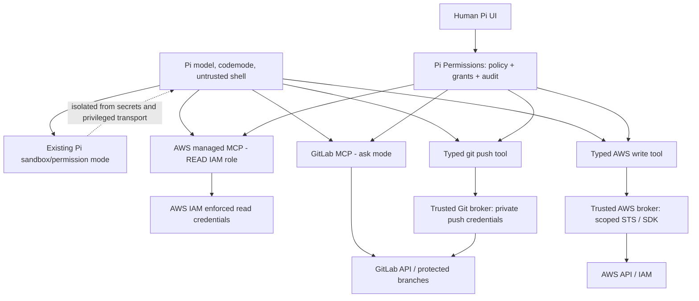

# Cross-domain Pi Permissions — AWS + Git + GitLab

Status: architecture proposal as of 2026-10-10, not implemented. Complements ARCHITECTURE.md and BACKLOG.md.

## Architecture strategy: one control plane, multiple enforcement planes

Pi provides common **user decision + Pi session grant state**, while resource adapters enforce separately. Avoid copying GitLab MCP's in-memory sticky approach to AWS or Git.

A Pi approval is only a **client-side authorization decision**. An actual IAM role, GitLab rights and Git push broker are independent enforcement layers. Do not rely on tokenless agent shell if it can reach an unintended signing proxy, SSH agent or credential helper.

## Uniform effects and granularity

`OperationIntent` contains: version; provider; verified principal/account; configured trusted endpoint; resource IDs; exact action(s); input/effect digest; side effects; risk class; optional session grant eligibility; nonce and originating invocation. Backend-specific schemas MUST NOT be assumed interchangeable. The matching key includes policy/classifier revision and scope.

| Layer | Examples | Prompt policy | Session sticky? |
|---|---|---|---|
| READ | Git log/status/fetch; AWS List/Describe/Get under restrictive IAM; GitLab queries | Usually allow with least privilege | No approval needed |
| LOCAL_WORKSPACE_WRITE | git add, commit, branch, new worktree, edit files in task workspace | Allow inside enforced sandbox; ask on risky local operations | Workspace-only under sandbox policy |
| RESTRICTED_REMOTE_WRITE | GitLab comment with all commands blocked; git push explicit feature branch ref; typed AWS S3 upload narrow ARN | Ask first; show complete effects and durable selection | Allowed only exact resource/action/actor after success |
| STATE_CHANGE | close issue, change MR target, alter pipeline, stop EC2, git tag, forced branch update | Ask each time, show consequences | Not by default |
| SECURITY_PRIVILEGED | AWS IAM/PassRole, GitLab admin, merge to protected default, security bypass or pipeline secret manipulation | Deny by default or dedicated elevated workflow | Never blanket sticky |
| OPAQUE_SCRIPT | AWS run_script with RW profile, arbitrary shell/SSH with creds, arbitrary GraphQL mutations, unknown push options | Deny remote write privileges | Never |

A read API is not necessarily harmless: cloud reads can expose credentials/data and incur cost. Sensitive reads may require explicit user approval despite AWS Read IAM access. 'Session grant' never implicitly crosses providers or credentials.

## AWS — keep existing managed MCP

1. AWS managed MCP Server via AWS Agent Toolkit and **only read-restricted IAM identity** in model-facing AWS profile. Allowlisted profiles, pin proxy version; use AWS IAM Read/List categorization and real per-service conditions. Never assume old preview aws-mcp actions protect writes; they are deprecated.
2. For controlled writes, prefer the **existing SDK** (not new AWS API MCP). Implement a small trusted Pi extension/broker tool with typed `aws.invoke` under explicit per-service allowlist. Broker alone holds privileged AWS credentials and short-lived STS credentials; model never receives them or generic script execution with those credentials.
3. STS session policies constrain delegated temporary role permissions; they do NOT enforce once-only semantics, and cannot increase privileges. Broker must execute precisely one typed API operation per approval, or a bounded declared transaction with all effects approved.
4. Start with subset of services actually needed; discovery/reads via official MCP stay universal. Future supported write service adapters are opt-in with policy fixtures and IAM action mapping.
5. For reads: AWS account, region, role/principal and data class bind policy; no sticky across account/profile change. Deny SecretsManager GetSecretValue, SSM GetParameter WithDecryption and other sensitive reads in the default profile if the user requires strict protection.

## Native Git — existing local sandbox + new privileged push broker

1. Keep OS-enforced Pi tool sandbox (candidate pi-permission-modes or pi-better-sandbox) for normal git status/log/diff/add/commit/worktree/fetch. **Audit before selecting**: some permission plugins intentionally run user-approved commands unsandboxed. Never infer that a mode named 'read-write' contains credentials.
2. Give agent only a **read-only GitLab deploy key** for fetch, or broker fetch if SSH-agent/key exposure cannot be bounded.
3. Privileged push only via typed API to trusted host broker: `{repoId, destinationRef, newCommitOid, expectedOldOid, options:[]}`. The broker may use secure Git transport or separate staging repository, but never process arbitrary agent shell commands, project .git config, pushInsteadOf rules, hooks, credential helper or remote URLs.
4. Exact original remote repository identity bound to configured GitLab numeric project and host. One ref at a time. No `--mirror`, `--all`, `--tags`, force, delete, custom receive-pack or `-o` without separately approved typed high-risk operation. Disable hidden default push options and use a fixed credential.
5. Analyze the pushed **commit graph** and relevant commit messages for issue-closing keywords, CI skip directives, GitLab CI config changes, tags, deletions, branch protections and push options. Display deferred effects even on feature branches. In absence of full project CI rules/hidden automation, note that whole-branch push can run code and cannot be treated as harmless.
6. Broker revalidates immediately before pushing and binds approval to **exact object ID**, target ref, expected old ref and computed effect digest. Cached branch grant may authorize subsequent proposed commits only after each proposal is fully reclassified and found within allowed effect class; grant is not automatic approval of unseen CI/security changes.
7. User's desired workflow: normal branch push can acquire session approval per repository+branch under safe policy; push to `main` and protected release branches always require fresh human approval (or deny); force/deletion/tags are distinct operations.
8. A broker implementation as Pi extension is likely simpler when only Pi needs it. Expose through MCP only when there is demonstrated multi-client need and a secure per-client identity/call association; do not build git-over-MCP for convenience.

## GitLab quick actions, commit messages and CI — single effect accounting

- Full GitLab quick actions execute from issue/MR/work-item descriptions and comments. **Commit comment** /tag is not the same thing as **commit message**, which does NOT generally execute slash quick actions. See research/gitlab-side-effects.md.
- `Closes #123` in commit or MR description is an issue closing pattern triggered on pushing/merging into default branch; may refer to cross-project issues and can remain deferred in a feature branch.
- `[ci skip]` / `[skip ci]` in commit messages skips relevant push CI; GitLab 19.5 also supports such directive in MR title for MR pipelines (feature-flag/version dependent). Sources: https://docs.gitlab.com/ci/pipelines/
- `git push -o ...` can create/auto-merge MR, skip CI, pass variables and potentially bypass protections. Disallow implicit and explicit push options in generic branch broker. Some quick actions may be injected in description passed via options; whether specific GitLab versions interpret them is a test gate, not assumed.
- **Do not grant a generic 'comment write' session permission to text containing possible slash actions.** First use strict reject of lines that might be quick actions; for a requested quick action expose separate typed operations where effect is known. Whitespace/CRLF/fences/versions may vary: prefer conservative block to incomplete blacklist.
- Issue closing / CI skip patterns embedded in text are not slash quick actions, so only filtering /^\// is NOT enough. Classify text fields based on their interpreter context and effects, not the leading character alone.
- A merge API approval should include proposed issue closures and pipeline/security implications, and must not be inferred from earlier feature branch approval. Changes can take place out-of-band and cannot be guaranteed prevented by Pi alone.
- GitLab backend permission and protected branch rules remain final authority, and cannot be bypassed by client grant. Disable undesired server-side automation when stronger guarantees are needed.

## Authorization order and concurrency

1. Agent requests operation in existing tool or new typed broker.
2. Entry transport classifies origin and actual arguments; Pi permissions validates context, session, grant and policy.
3. Backend builds complete effect footprint and verifies authoritative account/resource identity, with conditional lookups as needed.
4. Pi presents a clear summary or matches an existing narrow scoped grant. High-risk effects override reused low-risk grant.
5. Backend rechecks policy, actor, resource, SHA/version and destination immediately before API write/push (fail closed on drift), executes with bounded credential.
6. Pi records sticky grant only after known successful result, with session-global revoke tombstones. Unknown/partial success => no sticky.
7. Audit records sanitized identifiers, key/hash, decision, backend status and changed resources; never secrets, raw commit content, full source code or credential material.

## Known impossibility / explicit contract boundaries

- Authorization for a branch push cannot prove that code is innocuous or that CI will not perform dangerous actions. CI pipeline trust is an independent GitLab organizational configuration and runtime issue.
- Pi cannot prevent unrelated humans or automations from merging a commit with a closing pattern. GitLab-side protected branches / approvals / push rules are needed.
- API-call classification cannot guarantee precise indirect cost/side effects of every AWS service; IAM, SCP, service-specific controls and output audit backstop it.
- A writable credential visible to model bash invalidates claims of safe approval enforcement, regardless of plugin prompts.
- Git push can be accepted by server even if client later sees network failure; never retry automatically or cache grants on unknown outcome.
